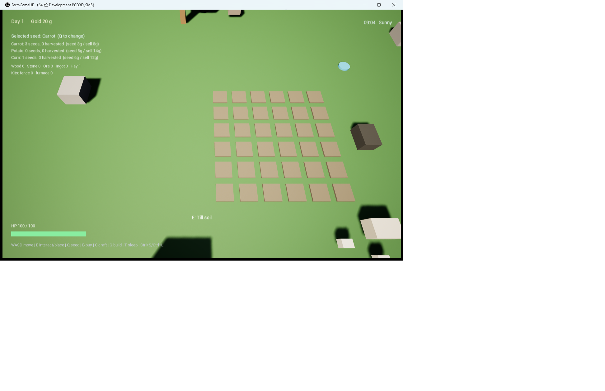
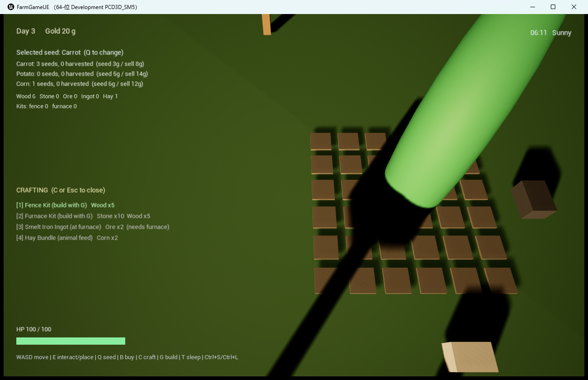
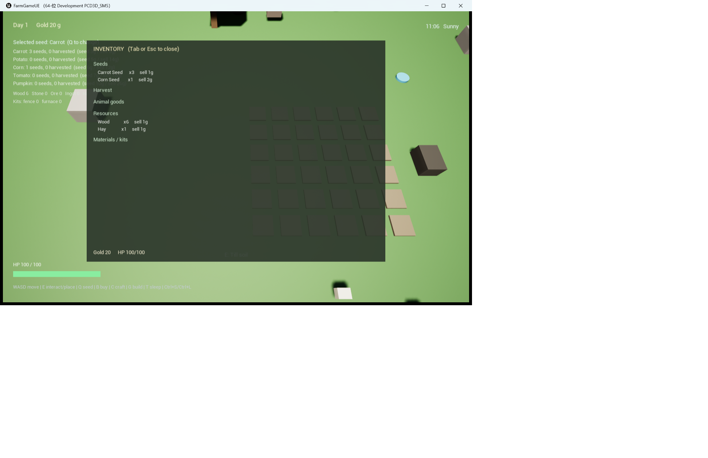
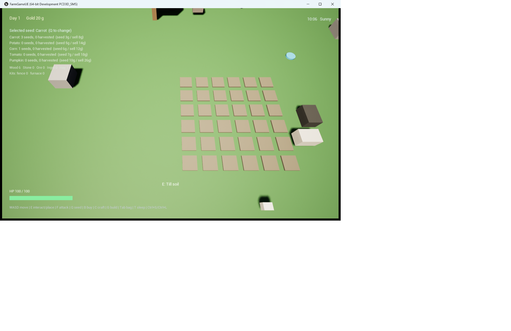
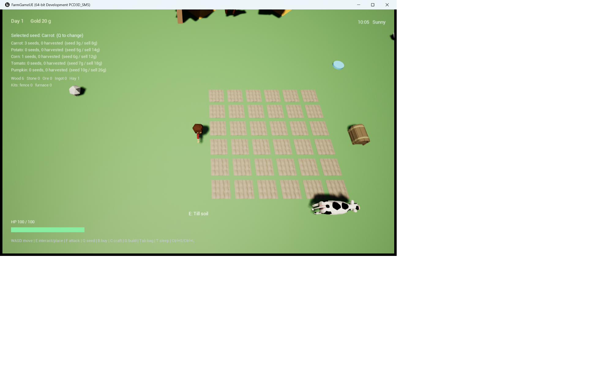
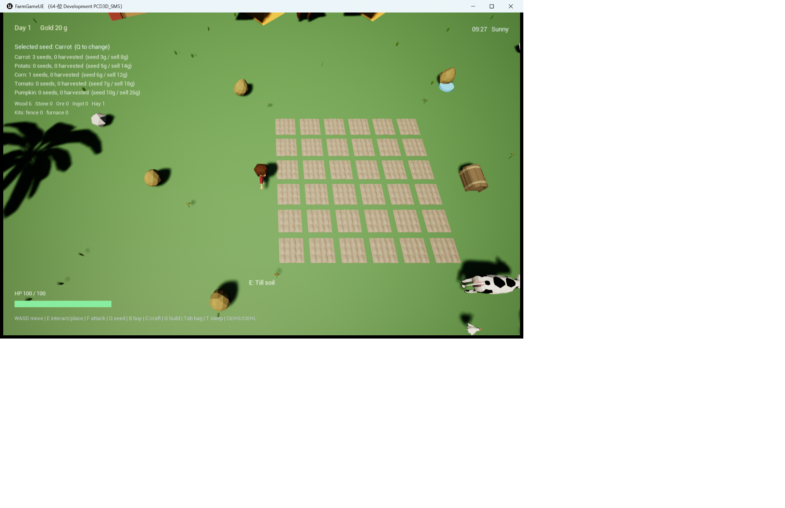

# FarmGame UE5（垂直切片 / Vertical Slice）

把 [RoyDevCh/FarmGame](https://github.com/RoyDevCh/FarmGame)（Unity 2021.3 + Farming Engine 框架）的核心玩法，
用 **Unreal Engine 5.8 + C++** 重做的一个可玩版本。

这不是 1:1 移植：先把"能玩、可验证、可继续扩展"的骨架立起来。规则、数据、存档、自动化测试都是 UE 原生 C++ 实现；
美术：导入 120+ 个原版模型（建筑/道具/树木/动物）、4 套骨骼动画与 7 个音效；地面/土壤用程序生成的可平铺贴图（`Content/Art/Textures`）（角色、鸡、牛、熊、五种作物、土壤、栅栏、熔炉、箱子、树、石头，以及谷仓/房屋/风车/棕榈/松树/灌木/花/草丛），运行时按包围盒自动归一化缩放；缺失时回退到 `/Engine/BasicShapes` 几何体。

**当前版本 v3**：在种田闭环（锄地 → 播种 → 浇水 → 过夜生长 → 收获 → 卖钱）之上，补齐了采集、制作、建造、
冶炼、养殖、战斗、传送、天气与昼夜光照；存档从"天数 + 金币 + 地块"扩展到建筑、动物、天气、HP，并有 3 个存档槽；
本轮又加入了开始/暂停菜单、设置面板、村口商店、食物与工具等级/8 段目标链；自动化测试从 5 条增加到 38 条。

截图摄于 v3：导入的原版美术 + Canvas HUD；右上角时间与天气、左下角 HP。

`C` 制作菜单：栅栏套件、熔炉套件、储物箱、斧/镐、钢斧/钢镐、铁锭（需熔炉）、干草。

`Tab` 背包总览：按种子 / 收成 / 动物产品 / 资源 / 材料 / 食物分组，显示数量与售价。

打包版 `Saved/Archive/Windows/FarmGameUE.exe` 实机启动：5 种作物、时间/天气、HP 与操作栏。

导入原版 FBX 后的农场：角色、牛、鸡、土壤、树、箱子（发货箱）。

`Tab` 背包/制作面板（Slate）：分组物品 + 可点击配方按钮，禁用项灰显。

## 功能（v3）

| 系统 | 内容 |
|---|---|
| 农田网格 | 6×6 = 36 块，间距 150；`Untilled → Tilled → Planted → Harvestable`，收获后回到 `Tilled` |
| 作物 | 5 种：胡萝卜 / 土豆 / 玉米 / 番茄 / 南瓜；阶段 3/3/4/3/4，每阶段 1/2/1/2/2 天，种子 3/5/6/7/10 金，售价 8/14/12/18/26 金；番茄收后回到阶段 1 可重复收获 |
| 生长规则 | 只有"浇过水"的 `Planted` 地块才会推进；每天结算一次；成熟后停在最后阶段等收获 |
| 时间 | 每天 180 秒，HUD 时钟 06:00 → 24:00（第 1 天从 09:00 开局，之后每天从 06:00 起）；`T` 睡觉立刻进入下一天 |
| 天气 | 每天切换时 1/4 概率下雨；雨天所有 `Planted` 地块自动浇水，阳光变暗、色温变冷 |
| 昼夜光照 | 定向光俯仰角按 `sin` 曲线走完一天；最后 20% 的白天亮度衰减到 35%，下限 1.1 |
| 经济 | 初始 20 金 / 3 胡萝卜种子 / 1 玉米种子 / 6 木头 / 1 干草；`B` 在发货箱旁买种子；发货箱 `E` 卖货 |
| 制作 | `C` 打开菜单或 `Tab` 面板，9 条配方：栅栏 / 熔炉 / 储物箱 / 斧 / 镐 / 钢斧 / 钢镐 / 铁锭（需熔炉）/ 干草；`1`–`5` 结算前 5 条，其余点按钮 |
| 建造 | `G` 循环 关闭 → 栅栏 → 熔炉 → 储物箱；预览落在身前 220、吸附 100 网格；`E` 放置并消耗套件 |
| 储物箱 | 12 木制作套件；`E` 一键存入全部木/石/矿/干草，再按一次全部取出；存量随存档保存 |
| 熔炉 | 装填"1 矿石 + 1 木头"，每 8 秒出 1 铁锭，最多同时堆 5 块矿石 |
| 采集 | 树 ×5（木）、石头 ×5（石）、矿脉 ×6（矿，在矿洞）；每个采集点每天复活 |
| 养殖 | 鸡 ×2、牛 ×1；喂 1 干草 → 次日产出 → `E` 收 1 蛋 / 1 奶 |
| 战斗 | 玩家 100 HP；左键 / `F` 近战 34 伤害（0.45 秒冷却、自动锁定 320 内最近的动物、不检查朝向）；野猪 60 HP，近身每 1.6 秒咬 8 点 |
| 传送 | 农场 (700, 700) ↔ 矿洞 (2600, 2600)，同一张地图上的两个传送点 |
| 存档 | `Ctrl+S` / `Ctrl+L` 存/读**当前槽位**（`FarmSlot1..3`，默认槽 1）：天数、当日进度、天气、金币、全部物品、HP、36 块地、建筑（含箱子库存）、动物、目标链进度 |
| HUD | Canvas 立即模式绘制：天数/金币、时间 + 天气、HP 条、目标行 `(进度/目标) +Ng`、种子与收成、材料、套件、交互提示、Toast |
| 背包 UI | `Tab` 打开 Slate 面板 `SFarmInventoryWidget`：6 类分组物品（含 Food）+ 9 条配方的可点击按钮；材料不足的按钮灰显，游戏内鼠标可用 |
| 动画 | 角色 idle/run/attack、鸡 idle/walk、牛 idle/walk、野猪 idle/attack（SkeletalMesh + AnimSequence；野猪追击不切跑步动画，受击播 bear_attack） |
| 村庄道具 | 水井、售卖亭、长椅、路灯、喷泉、木箱、水槽、告示牌、铁砧、大锅、石砖、土堆、池塘、树/枯树/仙人掌 |
| 材质/贴图 | `M_FarmGrassTiled` / `M_FarmSoilTiled` / `M_FarmWoodTiled`：噪声生成的可平铺贴图 + 材质；地表不再纯色 |
| 目标 | 8 段线性任务：收 3 胡萝卜 → 熔炉套件 → 铁锭 → 做斧头 → 收 5 玉米 → 冶炼 3 铁锭 → 商店买苹果 → 做钢斧；HUD 显示 `(进度/目标) +奖励`，完成自动发金币 |
| 工具 | 斧（木4+矿1，砍树 ×2）/ 镐（木4+矿2，采石矿 ×2）；钢斧（斧+矿5，砍树 ×3）/ 钢镐（镐+矿5，采石矿 ×3）；空手 ×1；持有工具时 `hand_R` 上挂对应模型（斧或镐，钢制沿用同一模型） |
| 开始菜单 | Slate 全屏菜单：`Continue`（当前槽无存档时灰显）/ `New game`（重载地图并带 `?autostart=1`）/ `Save slot: 1..3`（显示 `(empty)/(has save)`）/ `Settings` / `Quit`；暂停菜单为 `Resume`，隐藏 New game；快捷键 `C/N/S/Q` |
| 商店 | 村口水井旁的售卖亭 `AFarmShop`（`E` 打开 Slate 面板 `SFarmShopWidget`，打开期间暂停）：5 种种子、干草 4g、矿石 8g、木材 2g、石头 2g、苹果 5g、面包 8g；买不起时按钮灰显；另有 `Sell all goods` 一键卖货 |
| 食物 | `apple` / `bread` 为 `EItemKind::Food`；`H` 按面包 +20 > 苹果 +10 > 肉 +15 > 奶 +8 > 蛋 +5 的顺序吃第一个拥有的，回血上限 100 |
| 设置 | 开始/暂停菜单的 `Settings` 打开 Slate 面板 `SFarmSettingsWidget`：`Fullscreen`（窗口 ↔ 无边框全屏）、`Quality` 0..3、`Volume` 100/75/50/25/0、`Back`（Esc 返回）；设置持久化到 GameUserSettings.ini |
| 音效 | 7 个原版 WAV：锄地 / 播种 / 浇水 / 收获 / 制作 / 建造 / 挥击 / 命中；2D 播放，缺失静默 |
| 测试 | 38 条 UE Automation（`FarmGameTests.cpp` 32 条 + `FarmGameExtraTests.cpp` 6 条），全部纯逻辑 / 组件级，不依赖世界与资产 |
| 打包 | `Scripts/package.ps1` 跑通 BuildCookRun，产出 `Saved/Archive/Windows/FarmGameUE.exe`（本机已实测可启动） |

### 明确没做的（避免误读）

- **没有 UMG 资产**：背包/制作、开始/暂停菜单、商店、设置都是运行时构建的 **Slate** 控件（`SFarmInventoryWidget` / `SFarmMenuWidget` / `SFarmShopWidget` / `SFarmSettingsWidget`），不依赖 Widget 蓝图；常驻 HUD 仍是 `AHUD::DrawHUD` 的 Canvas 绘制。
- **没有独立 House 场景**：全工程只有 `/Game/Maps/Farm` 一张图，矿洞是同一张图东侧的一块空地，靠两个 `AFarmPortal` 往返。
- **没有宠物、塔防、陷阱、洒水器、混合锅、体力/饥饿/XP、手柄与触屏输入**；商店是售卖亭而不是可对话 NPC，储物箱只收 Resource（木/石/矿/干草），不是通用容器。
- **奖励只有金币且自动发放**：没有奖励选择、领取界面或任务日志；目标链是固定 8 段的线性链。
- **设置面板只做桌面窗口**：Fullscreen 只在"窗口 ↔ 无边框全屏"之间切换；没有分辨率列表、按键重绑；音量是 5 档粗调。从设置按 `Back` 会回到暂停菜单。
- **自动化测试不覆盖 UI 交互**：商店买卖点击、菜单/设置焦点、Slate 布局都没有 UI 级测试，只测纯逻辑与数据表。
- **手持工具未校准**：工具模型挂到 `hand_R`，但相对位置/旋转清零、按 45 cm 高缩放，实际握持姿态未逐个调过；钢制工具复用普通斧/镐模型。
- **食物美术大多未接入**：`Content/Art/Food` 下 80 个已导入资产，物品表只用了 `apple` / `bread`；其余建模没有对应物品与配方。

## 操作

| 按键 | 作用 |
|---|---|
| `W` `A` `S` `D` | 移动（固定俯视相机，无鼠标视角） |
| `E` | 交互：锄地 / 播种 / 浇水 / 收获 / 卖货 / 喂动物 / 收产物 / 装填熔炉 / 砍树采矿 / 传送 / 放置建筑 / 开商店 |
| 鼠标左键 / `F` | 攻击 320 内最近的动物（不看朝向；0.45 秒冷却，34 伤害） |
| `Q` | 切换当前种子（在菜单里 `Q` 是 Quit） |
| `B` | 在发货箱旁买 1 颗当前种子 |
| `C` | 打开 / 关闭制作菜单（在菜单里 `C` 是 Continue / Resume） |
| `1`–`5` | 结算前 5 条配方（共 9 条；其余在 `Tab` 面板里点按钮制作） |
| `G` | 建造模式：关闭 → 栅栏 → 熔炉 → 储物箱 |
| `H` | 吃食物回血：面包 +20 > 苹果 +10 > 肉 +15 > 奶 +8 > 蛋 +5（按此顺序吃第一个拥有的） |
| `Tab` | 打开 / 关闭背包总览（分类、数量、售价、金币、HP + 9 条配方按钮） |
| `T` | 睡觉，天数 +1 |
| `Esc` | 关闭商店 / 设置 → 关闭背包 / 制作菜单 → 退出建造模式 → 打开暂停菜单（暂停时再按返回游戏） |
| `Ctrl+S` / `Ctrl+L` | 存档 / 读档到当前槽位（`FarmSlot1..3`，默认槽 1；开始菜单按 `S` 切换） |
| 菜单快捷键 | `C` / `Enter` / `Space` 继续（暂停时为 Resume）、`N` 新游戏、`S` 切槽位、`Q` 退出、`Esc` 关闭暂停菜单 |

## 运行

1. 安装 **UE 5.8**（本机验证版本 5.8.4 / CL 58902052）。
2. 右键 `FarmGameUE.uproject` → Generate Visual Studio project files（或直接双击打开）。
3. 首次打开会编译 `FarmGameUE` 模块；打开地图 **/Game/Maps/Farm**，点 Play。
4. 打包版（本机已验证）：`powershell -File Scripts/package.ps1` → `Saved/Archive/Windows/FarmGameUE.exe`。
5. 或者直接跑独立游戏：

       UnrealEditor.exe FarmGameUE.uproject -game -windowed -ResX=1280 -ResY=800

几点补充：

- `/Game/Maps/Farm` 里只有 `FarmLandscape`（5×5、316×316）与 `/Game/Foliage/GrassType` 植被；地块、发货箱、商店、动物、采集点、
  传送门、太阳 / 天空球全部由 `AFarmGameMode::BuildWorld()` 在 BeginPlay 里程序化生成（有 Landscape 时不再生成地面 Plane）。
- GameMode 在 `Config/DefaultEngine.ini` 里全局指定为 `/Script/FarmGameUE.FarmGameMode`，不依赖蓝图；输入映射在 `Config/DefaultInput.ini`。
- 仓库里另有 `Scripts/package.ps1`（UBT 编译 + 可选 BuildCookRun 打包）、`Scripts/run-tests.ps1`（无头跑自动化测试并汇总）
  与 `.github/workflows/build.yml`（Windows self-hosted runner 上编译 + 测试 + 上传日志）；细节见 [Docs/BUILD.md](Docs/BUILD.md)。

## 测试

共 38 条 UE Automation 测试，统一挂在 `FarmGame.*` 前缀下：`FarmGameTests.cpp` 32 条，`FarmGameExtraTests.cpp` 6 条。

最省事的跑法（自动定位引擎、跑完打印通过/失败数量）：

    powershell -NoProfile -ExecutionPolicy Bypass -File .\Scripts\run-tests.ps1
    powershell -NoProfile -ExecutionPolicy Bypass -File .\Scripts\run-tests.ps1 -TestFilter FarmGame.Extra

等价的命令行：

    UnrealEditor-Cmd.exe FarmGameUE.uproject -ExecCmds="Automation RunTests FarmGame" -TestExit="Automation Test Queue Empty" -unattended -nopause -nosplash -nullrhi -log -stdout

`-TestExit="Automation Test Queue Empty"` 让编辑器在测试跑完后自己退出。不要在 `-ExecCmds` 里追加 `;Quit`：
那会在测试排队阶段就把编辑器关掉，一条测试都跑不完（CI 里也踩过这个坑）。

| 分组 | 测试 |
|---|---|
| `FarmGame.CropGrowth`（3） | `AdvancesWithWater` / `BlockedWithoutWater` / `MaturesAndStops` |
| `FarmGame.Crops`（2） | `CatalogSanity`（5 种作物、唯一 Id、正收益、种子/产物在目录中）/ `RegrowAfterHarvest`（番茄回到阶段 1，其余清空） |
| `FarmGame.Inventory`（7） | `BuyAndSell` / `CannotBuyWithoutGold` / `SellSkipsSeedsAndResources` / `UnknownItemRejected` / `EmptySaleIsNoop` / `ChestDepositWithdraw` / `SpendGoldIsAtomic` |
| `FarmGame.Crafting`（5） | `ConsumesIngredientsAndOutputs` / `HayFromCorn` / `FurnaceSmeltsOneOrePerInterval` / `ExactMaterialsConsumeAll` / `ChestRecipeCostsWood` |
| `FarmGame.Items`（2） | `CatalogIsConsistent` / `IdsAreUnique` |
| `FarmGame.Recipes`（3） | `CatalogReferencesKnownItems` / `IdsAreUnique` / `AllOutputsExistInCatalog` |
| `FarmGame.Save`（1） | `DefaultsAreSane` |
| `FarmGame.Quests`（3） | `AdvanceToCompletion` / `DefaultsReferenceItems` / `LastObjectiveIsSteelAxe` |
| `FarmGame.Tools`（3） | `GatherYieldDoubles`（空手/工具/钢制 = 1/2/3）/ `CatalogHasAxeAndPickaxe` / `SteelRecipesConsumeBaseTool` |
| `FarmGame.Shop`（1） | `StockIsValid`（商品都在物品表里且有正价格） |
| `FarmGame.Food`（2） | `CatalogHasAppleAndBread` / `ShopStockIncludesFood` |
| `FarmGame.Extra`（6） | `CropMultiStageContinuous` / `SmeltTwoStepsInARow` / `SellIncludesIngotKeepsSeedsAndResources` / `CraftFailureKeepsMaterials` / `SeedIdsForThreeCrops` / `RecipeOutputsInCatalog` |

测试全部是纯逻辑 / 组件级：生长与冶炼直接调 `FarmLogic` 的静态函数，库存与制作直接 `NewObject<UFarmInventoryComponent>()`，
不创建 `UWorld`、不启动 PIE，所以能在 `-nullrhi` 下跑。
本机 2026-11-09 的全量运行 **38/38 Success**（`Saved/Logs/FarmGameAutomation.log`，日志内 "38 tests performed"）；
测试逐条说明与排错见 [Docs/TESTING.md](Docs/TESTING.md)。

## 代码结构

    Source/FarmGameUE/
      FarmTypes.h                 FCropDef、EFarmPlotState、采集倍率、存档结构体、纯规则 FarmLogic
      FarmCropCatalog.h           5 种作物的默认表（测试也用它）
      FarmItems.h                 物品表（27 项）：类别 / 买价 / 卖价（含 Food）
      FarmRecipes.h               配方表（9 条）+ 熔炉前置标记
      FarmQuests.h                8 段目标链 + FarmQuests::Advance
      FarmPlot.*                  地块 Actor：状态机、生长推进、交互、视觉、存档快照
      FarmInventoryComponent.*    金币 / 物品背包：买卖、制作、结算、箱子存取
      FarmCharacter.*             俯视角色：胶囊 + 弹簧臂相机、HP、受伤与回农场
      FarmPlayerController.*      输入、就近目标、建造模式、制作、攻击、存读档、菜单/商店/设置
      FarmHUD.*                   Canvas HUD（含目标行）
      FarmArt.*                   原版 FBX 加载 + 包围盒归一化
      FarmInventoryWidget.*       Slate 背包/制作面板（9 条配方按钮）
      FarmMenuWidget.*            Slate 开始/暂停菜单（Continue / New game / 槽位 / Settings / Quit）
      FarmSettingsWidget.*        Slate 设置面板（全屏 / 画质 0..3）
      FarmShop.* / FarmShopWidget.*  村口售卖亭 + 购买/一键卖货面板
      FarmGameMode.*              作物目录、世界生成、昼夜与天气、每日推进、目标、3 槽存读档
      FarmBin.*                   发货箱（卖货）
      FarmAnimal.*                鸡 / 牛 / 野猪
      FarmResourceNode.*          树 / 石头 / 矿脉（按工具等级给 1/2/3 倍产出）
      FarmBuilding.*              栅栏 / 熔炉 / 储物箱（含冶炼 Tick）
      FarmPortal.*                农场 ↔ 矿洞传送点
      FarmSaveGame.h              USaveGame 存档数据
      FarmGameTests.cpp           基础自动化测试（32 条）
      FarmGameExtraTests.cpp      补充自动化测试（6 条）

更细的逐系统说明见 [Docs/FEATURES.md](Docs/FEATURES.md)，与原版（Unity）的逐项对照见 [Docs/DESIGN.md](Docs/DESIGN.md)。

## 从 Unity 到 UE5 的映射

| 原版（Unity / Farming Engine） | 本版（UE5） |
|---|---|
| `PlantData`（ScriptableObject）+ `Plant.cs` | `FCropDef`（USTRUCT，在 `AFarmGameMode` 构造函数里硬编码）+ `AFarmPlot` |
| `Plant.grow_time` / `growth_stage` / `grow_require_water` | `FCropDef::DaysPerStage` / `Stages`，`FarmLogic::AdvanceCrop` |
| `Soil.cs`（浇水 + 雨天自动浇） | `AFarmPlot::bWatered` + `AFarmPlot::WaterFromRain` |
| `ActionHoe` / `ActionPlant` / `ActionWaterPlant` / `ActionHarvest` | `AFarmPlot::Interact` 按 `EFarmPlotState` 分派 |
| `PlayerData` / `InventoryData` | `UFarmSaveGame` + `UFarmInventoryComponent` |
| `TheGame.cs` 的天数与 `onNewDay` | `AFarmGameMode::Day` / `DayLengthSeconds` / `AdvanceDay` |
| `WeatherSystem.cs` | `AFarmGameMode::bRaining`（1/4 概率；没有 WeatherData 资产，只有晴/雨两态） |
| `Furnace.cs` | `AFarmBuilding`（`EBuildingType::Furnace`）+ `FarmLogic::SmeltStep` |
| `CraftData` / `CraftPanel` | `FCraftRecipe` + `FarmRecipes::All` + `C` 菜单 |
| `Buildable` / `ActionBuild` | 建造模式（`AFarmPlayerController::ToggleBuildMode`）+ `AFarmBuilding` |
| `AnimalLivestock` / `AnimalWild` | `AFarmAnimal`（`EAnimalType`：Chicken / Cow / Boar） |
| `ExitZone` / `SceneNav`（Farm / House / Mine / Test 四场景） | `AFarmPortal`（单地图传送，无 House） |
| `SaveSystem` / `SaveTool`（JSON） | `USaveGame`（3 个槽位 `FarmSlot1..3`，存 `Saved/SaveGames/FarmSlotN.sav`） |
| `TheUI` / `ItemSlotPanel` / `CraftPanel` / `TimeClockUI` / `HPBar` | `AFarmHUD::DrawHUD`（Canvas）+ Slate：背包/制作、开始/暂停菜单、商店、设置 |

完整对照表（含"差异"与"未实现原因"）在 [Docs/DESIGN.md](Docs/DESIGN.md)。

## 路线图（原版还有的内容）

- 制作与建造的收尾：通用仓库、会说话的商店 NPC（当前只是售卖亭面板）、混合锅与烹饪、配方前置（原版 `CraftData.craft_requirements`）
- 动物与宠物：驯服、跟随、骑乘（`Pet.cs`、`ActionPetTame`、`AnimalRide`）
- 战斗扩展：陷阱、投射物、塔防（`Trap` / `Projectile` / `TowerAttack`）、武器与耐久
- 多场景：House（室内与家具）、真正的 Mine 关卡，以及场景切换（`ExitZone` / `SceneNav`）
- 天气系统化：多种天气资产、按游戏小时切换（原版 `WeatherSystem.weather_change_time` = 6 游戏小时）
- 角色属性：体力 / 饥饿 / XP / 等级（`PlayerCharacterAttribute`、`XPBar`、`AttributeBar`）
- 洒水器（`Sprinkler`）等自动浇水物件
- 背包面板的拖拽/使用/装备交互（当前只读 + 制作）、手柄与触屏输入
- 音频扩展：脚步 / UI / 环境音（当前只有 7 个动作音效，2D 播放）
- 数据资产化：把 `FCropDef` / `FItemDef` / `FCraftRecipe` 换成 DataAsset 或 DataTable；背包容量与堆叠上限（`ItemStack`）
- 美术继续替换：剩余建筑/树木/贴图与动画

## 说明

- 原版美术已导入 `Content/Art`（Character / Animals / Farming / Food / Buildings / Environment / Props / Textures 等目录）；
  仍有部分道具与装饰走 `/Engine/BasicShapes` + 动态材质的回退路径，Food 目录也大多只导入未接入玩法。
- 这是**可玩的垂直切片**：核心循环、经济、制作、建造、战斗、存档、测试都已打通，方便继续往上堆系统。
- 存档位置：`Saved/SaveGames/FarmSlot1.sav` ~ `FarmSlot3.sav`（当前槽由开始菜单的 `S` 决定，默认 1）；删掉对应文件即可重开该槽（新档 = 20 金 + 若干初始物资）。
- 灵感与玩法来源：[RoyDevCh/FarmGame](https://github.com/RoyDevCh/FarmGame)。

## 地形与植被（MCP 工作流）

- 地形：`/Game/Maps/Farm` 内的 `FarmLandscape`，5×5 组件、316×316、extent 15750；高度图在 `Saved/Heightmaps/farm.raw`（导入/导出字节一致）。
- 植被：`/Game/Foliage/GrassType`（草模型），4 条带共 480 个实例；`get_foliage_instances` 回读通过。
- 生成方式：ue-control-mcp v0.3.0 的 EngineWire `create_landscape` / `edit_landscape(import_heightmap)` / `create_foliage_type` / `paint_foliage_instances`。
- `batch_import`（带 options）导入了 8 个作物生长阶段模型；`import_animation` 重新导入了 `bear_idle`（长度 6.21s，Skeleton 校验通过）。
- EngineWire 是本地开发插件，**不随仓库提交**；换机器后用 `project_setup` 重新接入。
