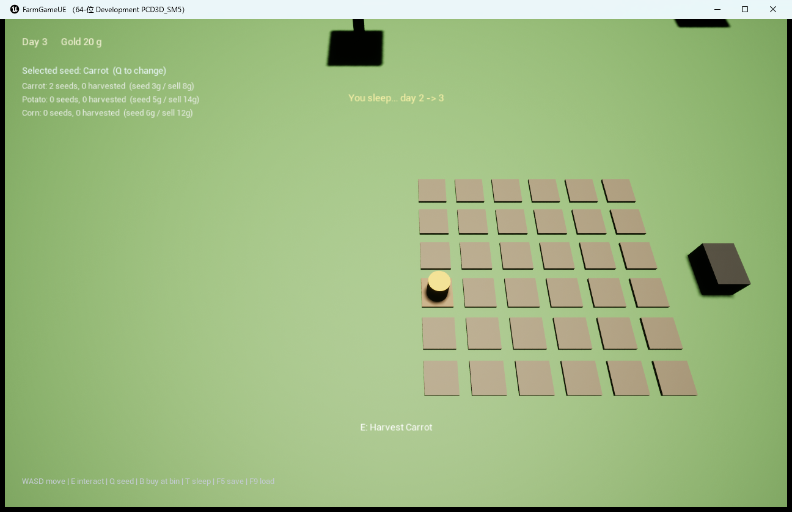

# FarmGame UE5（垂直切片 / Vertical Slice）

把 [RoyDevCh/FarmGame](https://github.com/RoyDevCh/FarmGame)（Unity 2021.3 + Farming Engine 框架）
的核心种田循环，用 **Unreal Engine 5.8 + C++** 重做的一个可玩版本。

这不是 1:1 完整移植，而是先把"能玩、可验证、可继续扩展"的骨架立起来：
数据、规则、存档、自动化测试都是 UE 原生实现，美术暂时用引擎基础几何体占位。

## 已实现

| 系统 | 说明 |
|---|---|
| 农田网格 | 6×6 地块，锄地 → 播种 → 浇水 → 过夜生长 → 收获 → 回到可耕种 |
| 作物 | 胡萝卜 / 土豆 / 玉米；阶段数、每阶段天数、种子价、售价、产量均为数据 |
| 生长规则 | 浇水后才生长；跨天推进；未浇水不增长；成熟后停在最后阶段 |
| 经济 | 初始 20 金币 + 3 颗胡萝卜种子；种子按价格购买；收获物到发货箱出售 |
| 时间 | 每天 180 秒自动推进；T 键睡觉直接跳到下一天 |
| HUD | 天数 / 金币 / 每种作物的种子与收成 / 当前种子 / 交互提示 / 操作帮助 |
| 存档 | F5 保存、F9 读取（USaveGame：天数、金币、背包、全部地块状态） |
| 测试 | 5 条 UE Automation 测试（生长 3 条 + 经济 2 条），全部通过 |

## 操作

    WASD   移动（固定俯视相机）
    E      交互：锄地 / 播种 / 浇水 / 收获 / 卖货
    Q      切换种子
    B      在发货箱旁买 1 颗当前种子
    T      睡觉（天数 +1）
    F5/F9  保存 / 读取

## 运行

1. 安装 **UE 5.8**（本机为 5.8.4 / CL 58902052）。
2. 右键 `FarmGameUE.uproject` → Generate Visual Studio project files（或直接双击打开）。
3. 首次打开会编译 `FarmGameUE` 模块；打开地图 **/Game/Maps/Farm**，点 Play。
4. 或者直接跑独立游戏：

       UnrealEditor.exe FarmGameUE.uproject -game -windowed -ResX=1280 -ResY=800

## 测试

    UnrealEditor-Cmd.exe FarmGameUE.uproject -ExecCmds="Automation RunTests FarmGame;Quit" -unattended -nullrhi -log

结果：`FarmGame.CropGrowth.*`（3 条）与 `FarmGame.Inventory.*`（2 条）共 5 条全部 Success。

## 代码结构

    Source/FarmGameUE/
      FarmTypes.h                 作物定义 FCropDef、地块状态、纯规则 FarmLogic
      FarmPlot.*                  地块 Actor：状态机、生长推进、交互、存档快照
      FarmInventoryComponent.*    金币 / 种子 / 收成，买卖与结算
      FarmCharacter.*             俯视角色（胶囊 + 弹簧臂相机）
      FarmPlayerController.*      输入、就近交互目标、存档/读档/睡觉
      FarmHUD.*                   Canvas HUD
      FarmGameMode.*              作物目录、世界生成、昼夜、存读档
      FarmBin.*                   发货箱（卖货）
      FarmSaveGame.h              USaveGame 数据
      FarmGameTests.cpp           5 条自动化测试

## 从 Unity 到 UE5 的映射

| 原版（Unity / Farming Engine） | 本版（UE5） |
|---|---|
| Plant.cs + PlantData.asset | `AFarmPlot` + `FCropDef`（C++ 结构，后续可换 DataAsset） |
| Plant.grow_time / growth_stage | `FCropDef::DaysPerStage` / `Stages`，`FarmLogic::AdvanceCrop` |
| ActionHoe / ActionPlant / ActionWaterPlant / ActionHarvest | `AFarmPlot::Interact` 按状态分派 |
| PlayerData / InventoryData / 存档 | `UFarmSaveGame`（USaveGame）+ `UFarmInventoryComponent` |
| TheGame.cs 时间与天数 | `AFarmGameMode::Day` / `DayLengthSeconds` / `AdvanceDay` |
| Canvas UI（ItemSlotPanel 等） | `AFarmHUD::DrawHUD`（后续可换 UMG） |
| 四个场景 Farm/House/Mine/Test | 暂只有 Farm 一张图（程序化生成） |

## 路线图（原版还有的内容）

- 建造与制作：围栏/熔炉/箱子、配方分类、冶炼与混合锅
- 动物与宠物：喂养、产出、驯服、协助
- 战斗与野生动物 AI、陷阱、塔防
- 多场景：House / Mine，以及场景间无缝切换
- 天气、昼夜光照曲线、体力/饥饿等角色属性
- UMG 背包与制作面板、手柄与移动端输入
- 把美术从占位几何体替换为原版 FBX/PNG（需要处理导入与授权）

## 说明

- 原版美术资源（337 个 FBX、325 张贴图）没有导入：一是体积，二是许可边界。
  当前所有物体都是 `/Engine/BasicShapes` + 动态材质染色。
- 这是**可玩的垂直切片**：核心循环、经济、存档、测试都已打通，方便继续往上堆系统。
- 灵感与玩法来源：[RoyDevCh/FarmGame](https://github.com/RoyDevCh/FarmGame)。
